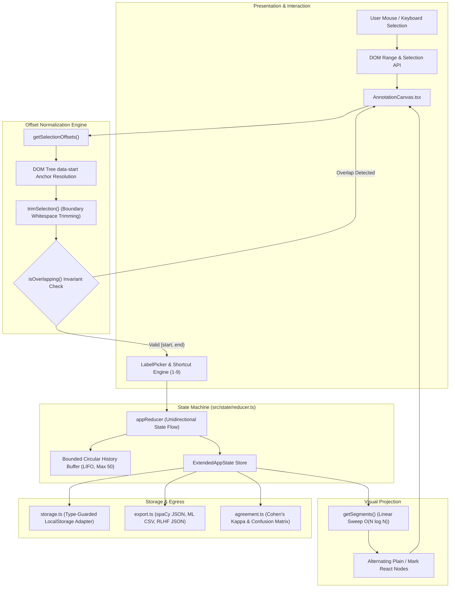
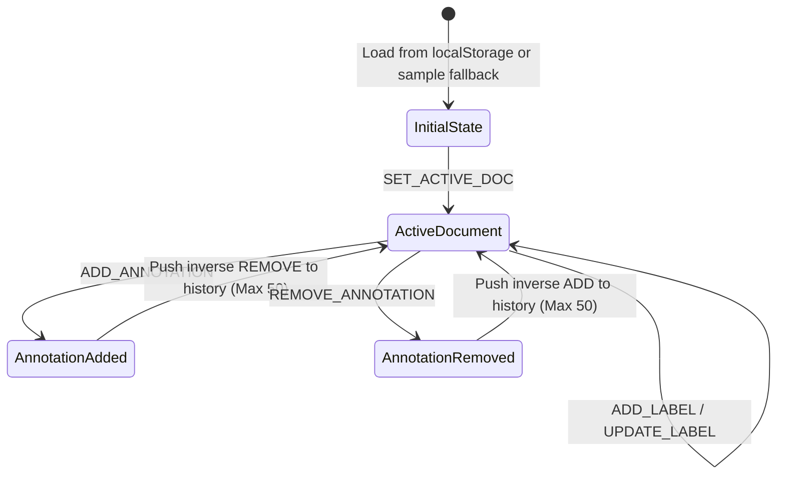

# DocSpan — Production-Grade Text Annotation & RLHF Studio

[](https://www.typescriptlang.org/)
[](https://react.dev/)
[](https://vitejs.dev/)
[](https://vitest.dev/)
[](https://oxc.rs/)
[](./LICENSE)

**DocSpan** is a zero-latency, client-first text annotation and Reinforcement Learning from Human Feedback (RLHF) preference studio. Engineered to replace cumbersome Docker/Python annotation stacks (Label Studio, doccano) for text classification and Named Entity Recognition (NER), DocSpan runs entirely in the browser with **deterministic offset stability**, **zero backend dependencies**, and **inter-annotator agreement (IAA) statistics**.

---

## 📑 Table of Contents

1. [Architectural Philosophy](#-architectural-philosophy)
2. [System Architecture & Data Flow](#-system-architecture--data-flow)
3. [Algorithmic Deep Dive](#-algorithmic-deep-dive)
   - [Linear Segment Walker](#1-pure-segment-walker-on-log-n)
   - [DOM-to-Character Offset Normalization](#2-dom-to-character-offset-normalization)
   - [Non-Overlapping Span Invariant](#3-collision-detection--overlap-invariants)
   - [Inter-Annotator Agreement (Cohen's Kappa with Negative Class)](#4-inter-annotator-agreement-iaa-formulation)
4. [Data Contracts & ML Export Schemas](#-data-contracts--ml-export-schemas)
5. [State Machine & Undo Engine](#-state-machine--undo-engine)
6. [Core Capabilities & Workflows](#-core-capabilities--workflows)
7. [Repository Structure](#-repository-structure)
8. [Testing & Quality Assurance](#-testing--quality-assurance)
9. [Getting Started & Toolchain](#-getting-started--toolchain)
10. [Engineering Trade-offs & Deliberate Exclusions](#-engineering-trade-offs--deliberate-exclusions)

---

## 🏛 Architectural Philosophy

Most browser-based text annotation prototypes make a fatal mistake: they treat document text as mutable DOM or manipulate raw strings by injecting inline HTML tags (e.g., `<mark>` or `<span>`). This introduces critical defects:

1. **Offset Drift & Mutation Cascades**: Injected markup changes string indices. Once you add `<mark>John</mark>`, all subsequent character offsets shift, invalidating token alignments for tokenizers (BPE, WordPiece, SentencePiece).
2. **`contentEditable` Non-Determinism**: Browsers insert platform-specific `<div>`, `<br>`, and nested `<span>` nodes upon selection or keyboard input, corrupting canonical text.
3. **Loss of Idempotency**: Undoing, reordering, or editing annotations becomes an error-prone string replacement game.

### The DocSpan Invariant: Canonical Text Immutability

DocSpan enforces strict decoupling:
- **Raw Document Text is Frozen**: The underlying text is treated as an immutable byte/character sequence.
- **Annotations are Pure Offset Tuples**: Stored strictly as `[start, end]` half-open intervals `[start, end)` referencing canonical string indices.
- **Rendering is a Projection**: The visual document is rendered on the fly via a **pure segment walker** that projects `(immutableText, sortedAnnotations)` into a contiguous stream of non-mutating React VDOM nodes carrying anchored `data-start` metadata.

---

## 🔄 System Architecture & Data Flow



---

## 🔬 Algorithmic Deep Dive

### 1. Pure Segment Walker ($O(N \log N)$)
Located in [`src/utils/segments.ts`](file:///home/venkatesh-yadagiri/Documents/PROJECTS%20%21/Text-Annotation-tool/src/utils/segments.ts).

To render highlighted text without touching the raw document, the segment walker transforms `text` and `Annotation[]` into a linear sequence of typed chunks (`Segment`):

$$\text{Segments} = \text{SegmentWalker}(T, \mathcal{A})$$

1. **Sort & Validate**: Filters annotations within bounds $[0, |T|]$ and sorts by $a.\text{start}$ ascending.
2. **Sweep-Line Traversal**: Maintains an index pointer $\text{currentIndex} \in [0, |T|]$:
   - For each annotation $a$:
     - If $a.\text{start} > \text{currentIndex}$, emit an unannotated `plain` segment for substring $T[\text{currentIndex} : a.\text{start}]$.
     - Emit an `annotated` segment for substring $T[a.\text{start} : a.\text{end}]$, attaching the `annotation` reference.
     - Advance $\text{currentIndex} \leftarrow a.\text{end}$.
   - If $\text{currentIndex} < |T|$, emit a trailing `plain` segment for the remainder.
3. **Complexity**: $O(N \log N)$ sorting step for $N$ annotations, followed by $O(N)$ linear emission. Space complexity is $O(N)$ segment descriptors.

### 2. DOM-to-Character Offset Normalization
Located in [`src/utils/offsets.ts`](file:///home/venkatesh-yadagiri/Documents/PROJECTS%20%21/Text-Annotation-tool/src/utils/offsets.ts).

Browsers return selection boundaries relative to the immediate `TextNode` inside whichever arbitrary HTML wrapper contains the cursor. When text is split across multiple `<span>` or `<mark>` segments, native `window.getSelection().anchorOffset` does not correspond to document index.

DocSpan solves this through **anchored offset propagation**:
1. Every emitted segment element bears a `data-start="k"` HTML attribute indicating its absolute document index.
2. When the user releases a mouse or finishes a keyboard shift-selection:
   ```typescript
   export function getAbsoluteOffsetFromNode(
     containerEl: HTMLElement,
     node: Node,
     offset: number
   ): number | null {
     const el = node.nodeType === Node.ELEMENT_NODE ? (node as HTMLElement) : node.parentElement;
     const segmentEl = el?.closest("[data-start]") as HTMLElement | null;
     if (!segmentEl || !containerEl.contains(segmentEl)) return null;

     const baseOffset = parseInt(segmentEl.getAttribute("data-start") || "0", 10);
     return baseOffset + calculateIntraSegmentOffset(segmentEl, node, offset);
   }
   ```
3. **Whitespace Boundary Sanitization**: Highlighting sentences frequently captures trailing or leading space characters. `trimSelection()` runs regex matching against the selected substring slice to snap boundaries directly to non-whitespace tokens:
   $$\text{trimmedStart} = \text{start} + |\text{leadingWhitespace}|$$
   $$\text{trimmedEnd} = \text{end} - |\text{trailingWhitespace}|$$

### 3. Collision Detection & Overlap Invariants
Located in [`src/utils/offsets.ts`](file:///home/venkatesh-yadagiri/Documents/PROJECTS%20%21/Text-Annotation-tool/src/utils/offsets.ts).

For standard token classification and BIO/BILOU tagging sequences, entity spans must remain strictly partitionable. Two half-open intervals $[A_{\text{start}}, A_{\text{end}})$ and $[B_{\text{start}}, B_{\text{end}})$ intersect if and only if:

$$\max(A_{\text{start}}, B_{\text{start}}) < \min(A_{\text{end}}, B_{\text{end}})$$

DocSpan guarantees this invariant:
- Adjacent intervals (e.g. $[0, 5)$ and $[5, 10)$) evaluate to $\max(0, 5) < \min(5, 10) \implies 5 < 5 \implies \text{false}$, and are admitted without conflict.
- Any intersecting selection is immediately intercepted with an informative inline collision prompt rather than crashing or creating malformed overlapping tags.

### 4. Inter-Annotator Agreement (IAA) Formulation
Located in [`src/utils/agreement.ts`](file:///home/venkatesh-yadagiri/Documents/PROJECTS%20%21/Text-Annotation-tool/src/utils/agreement.ts).

Measuring consistency across human annotators is vital for data curation. Many naive tools calculate agreement only over the subset of spans both annotators identified. This produces heavily inflated agreement by ignoring spans missed by one annotator.

DocSpan computes span-level Cohen's Kappa over the **complete union of candidate spans**:

$$U = \{ (d, s, e) \mid \text{span } [s, e) \text{ tagged in doc } d \text{ by Annotator } A \lor B \}$$

If Annotator $A$ tagged span $u \in U$ as label $L$ but Annotator $B$ did not annotate that span at all, Annotator $B$'s classification is explicitly assigned to a synthetic negative category:

$$B(u) = \text{\_\_NONE\_\_}$$

#### Mathematical Formulation:
- **Observed Agreement ($P_o$)**:
  $$P_o = \frac{\sum_{u \in U} \mathbb{I}[A(u) = B(u)]}{|U|}$$

- **Hypothetical Chance Agreement ($P_e$)**:
  $$P_e = \sum_{k \in \mathcal{C}} P(A = k) \cdot P(B = k) = \sum_{k \in \mathcal{C}} \left( \frac{\sum_u \mathbb{I}[A(u) = k]}{|U|} \times \frac{\sum_u \mathbb{I}[B(u) = k]}{|U|} \right)$$
  *(where $\mathcal{C}$ is the set of all observed labels plus $\text{\_\_NONE\_\_}$)*

- **Cohen's Kappa ($\kappa$)**:
  $$\kappa = \frac{P_o - P_e}{1 - P_e}$$
  *Interpreted via Landis & Koch (1977) scale: Slight (0–0.2), Fair (0.2–0.4), Moderate (0.4–0.6), Substantial (0.6–0.8), Almost Perfect (0.8–1.0).*

- **Span-Level Micro F1**:
  $$F_1 = \frac{2 \cdot |A \cap B|}{|A| + |B|}$$

---

## 📦 Data Contracts & ML Export Schemas

### 1. Internal TypeScript Representation ([`src/types.ts`](file:///home/venkatesh-yadagiri/Documents/PROJECTS%20%21/Text-Annotation-tool/src/types.ts))

```typescript
export interface Label {
  id: string;
  name: string;
  color: string;
  shortcut: string;
  description?: string;
  example?: string;
}

export interface Annotation {
  id: string;
  start: number;       // Inclusive character index
  end: number;         // Exclusive character index
  labelId: string;     // Foreign key referencing Label.id
}

export interface Doc {
  id: string;
  text: string;
  annotations: Annotation[];
  status: "pending" | "done";
  secondsSpent: number;
  title?: string;
}
```

### 2. Export Format: spaCy / Hugging Face Compatible JSON

Exported via the header modal as structured JSON ready for ingestion by NLP pipelines:

```json
{
  "exportedAt": "2026-10-13T21:30:00.000Z",
  "documentCount": 3,
  "totalAnnotations": 8,
  "docs": [
    {
      "id": "doc-1",
      "title": "Quantum Computing Breakthrough",
      "text": "Sundar Pichai visited London yesterday to announce...",
      "status": "done",
      "secondsSpent": 42,
      "annotations": [
        {
          "id": "ann-1729000000-xyz",
          "start": 0,
          "end": 13,
          "text": "Sundar Pichai",
          "labelId": "lbl-person",
          "labelName": "PERSON",
          "labelColor": "#6366f1"
        }
      ]
    }
  ]
}
```

### 3. Flat CSV Training Schema

```csv
doc_id,start,end,text,label
doc-1,0,13,"Sundar Pichai",PERSON
doc-1,22,28,"London",LOCATION
```

---

## 🕹 State Machine & Undo Engine

State management is centralized in [`src/state/reducer.ts`](file:///home/venkatesh-yadagiri/Documents/PROJECTS%20%21/Text-Annotation-tool/src/state/reducer.ts) using React 19's `useReducer`.



### Bounded Inverted-Action History Stack
Rather than deep-cloning full state snapshots on every keystroke (which inflates memory footprint), DocSpan stores atomic **inverse transitions** in a circular LIFO stack bounded at 50 actions:

```typescript
export interface HistoryAction {
  type: "ADD" | "REMOVE";
  docId: string;
  annotation: Annotation;
}
```
- **Adding an annotation** pushes a `{ type: "ADD", docId, annotation }` record to the history buffer.
- Triggering **Undo (`⌘Z` / `Ctrl+Z`)** executes the inverse operation: if the last action was `ADD`, it filters out that annotation; if `REMOVE`, it restores the annotation with original offsets and label metadata.
- Time Complexity for undo: $O(K)$ where $K$ is the number of annotations in the active document. Space Complexity: strictly $O(1)$ memory ceiling.

---

## ⚡ Core Capabilities & Workflows

| Capability | Module | Engineering Highlight |
|---|---|---|
| **Highlighter Canvas** | [`AnnotationCanvas.tsx`](file:///home/venkatesh-yadagiri/Documents/PROJECTS%20%21/Text-Annotation-tool/src/components/AnnotationCanvas.tsx) | Selection resolution using `data-start` traversal. Real-time floating quick-action pill toolbar. Clean badge rendering with accessible contrast. |
| **Document Queue** | [`DocumentQueue.tsx`](file:///home/venkatesh-yadagiri/Documents/PROJECTS%20%21/Text-Annotation-tool/src/components/DocumentQueue.tsx) | Substring search, pending/done status toggling, per-document timers, auto-advancing queue on "Mark Done", and "+ New Document" modal. |
| **Annotation Guidelines** | [`GuidelinesPanel.tsx`](file:///home/venkatesh-yadagiri/Documents/PROJECTS%20%21/Text-Annotation-tool/src/components/GuidelinesPanel.tsx) | Collapsible drawer with label descriptions, positive/negative examples, and in-place editing with immediate state sync. |
| **IAA Analysis** | [`AgreementModal.tsx`](file:///home/venkatesh-yadagiri/Documents/PROJECTS%20%21/Text-Annotation-tool/src/components/AgreementModal.tsx) | Computes Cohen's Kappa, percent agreement, F1 score, confusion matrices, and precision/recall breakdowns across two uploaded JSON files or built-in test fixtures. |
| **RLHF Preference Mode** | [`PreferenceRanking.tsx`](file:///home/venkatesh-yadagiri/Documents/PROJECTS%20%21/Text-Annotation-tool/src/components/PreferenceRanking.tsx) | Model response comparison (Model A vs Model B) with rationale comments, preference choice (A/B/Tie), and JSON dataset export for DPO/PPO fine-tuning. |
| **Resilient Storage** | [`storage.ts`](file:///home/venkatesh-yadagiri/Documents/PROJECTS%20%21/Text-Annotation-tool/src/state/storage.ts) | Runtime type validation for `localStorage`. Prevents quota exceptions and gracefully recovers corrupted state by rolling back to verified defaults. |

---

## 📁 Repository Structure

```
Text-Annotation-tool/
├── .oxlintrc.json                 # Oxlint static analysis configuration
├── DECISIONS.md                   # Formal Architectural Decision Records (ADRs)
├── README.md                      # Senior Developer Architectural Documentation
├── index.html                     # HTML5 entrypoint with Google Fonts typography
├── package.json                   # Dependency tree (React 19, Vite 8, Lucide, Vitest)
├── tsconfig.json                  # Monorepo TypeScript configuration
├── src/
│   ├── App.tsx                    # Root application component & mode orchestration
│   ├── index.css                  # Design system: editorial light paper & obsidian dark themes
│   ├── types.ts                   # Core domain types and data contracts
│   ├── components/
│   │   ├── AgreementModal.tsx     # Inter-Annotator Agreement analytics modal
│   │   ├── AnnotationCanvas.tsx   # Core text reader with offset-aware highlights
│   │   ├── AnnotationList.tsx     # Sidebar list of active document entities
│   │   ├── DocumentQueue.tsx      # Document navigation list, search, and progress metrics
│   │   ├── ExportModal.tsx        # JSON/CSV file download interface
│   │   ├── GuidelinesPanel.tsx    # In-app label definitions and boundary rules
│   │   ├── Header.tsx             # Top navigation, mode switch, and theme toggler
│   │   ├── LabelPicker.tsx        # Shortcut bar (1-9) with color swatches
│   │   ├── PreferenceRanking.tsx  # RLHF pairwise response ranking studio
│   │   ├── ProgressBar.tsx        # Visual task completion progress indicator
│   │   └── ShortcutsModal.tsx     # Modal displaying keyboard accelerator cheatsheet
│   ├── data/
│   │   └── sample-docs.json       # Preloaded NLP datasets (biomedical, news, legal)
│   ├── state/
│   │   ├── reducer.ts             # Pure state machine & circular undo history buffer
│   │   └── storage.ts             # LocalStorage adapter with type guards and fallback
│   └── utils/
│       ├── agreement.ts           # Cohen's Kappa, confusion matrix & F1 algorithms
│       ├── export.ts              # JSON/CSV serialization and browser file download triggers
│       ├── offsets.ts             # DOM range to absolute character offset converter
│       └── segments.ts            # Linear segment walker interval partitioning algorithm
└── tests/
    ├── agreement.test.ts          # Cohen's Kappa & inter-annotator statistical tests
    ├── components.test.tsx        # React Component integration tests (testing-library)
    ├── offsets.test.ts            # DOM offset calculations & overlap checking unit tests
    ├── reducer.test.ts            # Reducer state transitions & undo action stack tests
    └── segments.test.ts           # Pure segment walker interval boundary tests
```

---

## 🧪 Testing & Quality Assurance

DocSpan features comprehensive test coverage spanning algorithmic calculations, state machine transitions, and interactive UI components:

```bash
# Execute full Vitest test suite once
npm test

# Run tests in interactive watch mode
npm run test:watch
```

### Test Suite Breakdown:
- **`tests/segments.test.ts`**: Verifies empty string handling, single spans, non-overlapping adjacent spans, edge spans ($start = 0$ and $end = |T|$), and correct plain/annotated slice partitioning.
- **`tests/offsets.test.ts`**: Verifies regex-based boundary whitespace trimming, overlap rejection invariants ($\max(A_s, B_s) < \min(A_e, B_e)$), and adjacent-boundary permission.
- **`tests/agreement.test.ts`**: Validates 100% agreement on identical datasets, zero agreement on non-overlapping labels, Cohen's $\kappa$ bounds ($\kappa \in [-1.0, 1.0]$), and synthetic `__NONE__` category weighting.
- **`tests/reducer.test.ts`**: Validates `ADD_ANNOTATION`, `REMOVE_ANNOTATION`, `UNDO` reversal, `TICK_TIMER`, and `MARK_DONE` transitions.
- **`tests/components.test.tsx`**: Integration tests verifying that selection renders appropriately and label badges display corresponding keyboard shortcut tokens.

---

## 🚀 Getting Started & Toolchain

### Prerequisites
- **Node.js**: v18.0.0 or later (Node 20+ LTS recommended)
- **Package Manager**: `npm`, `pnpm`, or `yarn`

### Setup & Local Development
```bash
# 1. Clone repository
git clone https://github.com/your-username/text-annotation-tool.git
cd text-annotation-tool

# 2. Install dependencies
npm install

# 3. Launch Vite development server with HMR
npm run dev
```
Navigate to `http://localhost:5173` in your browser.

### Static Code Quality & Production Bundle
```bash
# Run oxlint for sub-second static analysis
npm run lint

# Compile TypeScript and generate optimized production bundle
npm run build

# Preview production bundle locally
npm run preview
```
The compiled assets in `dist/` are static and ready for direct hosting on CDN targets (Vercel, Cloudflare Pages, Netlify, or AWS S3 + CloudFront).

---

## ⚖️ Engineering Trade-offs & Deliberate Exclusions

| Choice | Alternative Considered | Senior Engineering Rationale |
|---|---|---|
| **Flat, Non-Overlapping Spans** | Nested / Discontinuous Spans | **Flat spans correspond directly to standard token classification (BIO/BILOU schemes)**. Allowing arbitrary overlapping intervals requires interval trees and fragmented split tags that degrade annotator velocity and introduce ambiguities into standard downstream training pipelines. |
| **Client-Side `localStorage`** | Heavy Docker / PostgreSQL API | Eliminates 100% of deployment friction, operational maintenance, and authentication overhead. Annotators can boot up immediately, work completely offline, and serialize state out to canonical JSON/CSV when finished. |
| **Pure Segment Projection** | `contentEditable` / Dynamic Markup | `contentEditable` is notoriously non-deterministic across browser engines and corrupts string indices. Projecting immutable strings into VDOM guarantees that character offsets match ground truth raw text. |
| **Explicit Negative Class in IAA** | Restricting IAA to Matched Spans | Restricting agreement to intersecting spans ignores recall discrepancies and inflates Kappa scores. Modeling missing spans as `__NONE__` forces authentic statistical accountability. |

---

## 📄 License
DocSpan is open-source software licensed under the [MIT License](./LICENSE).
